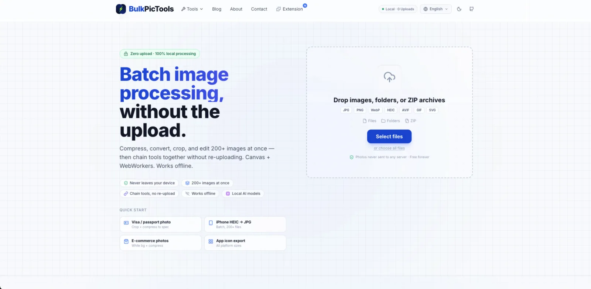
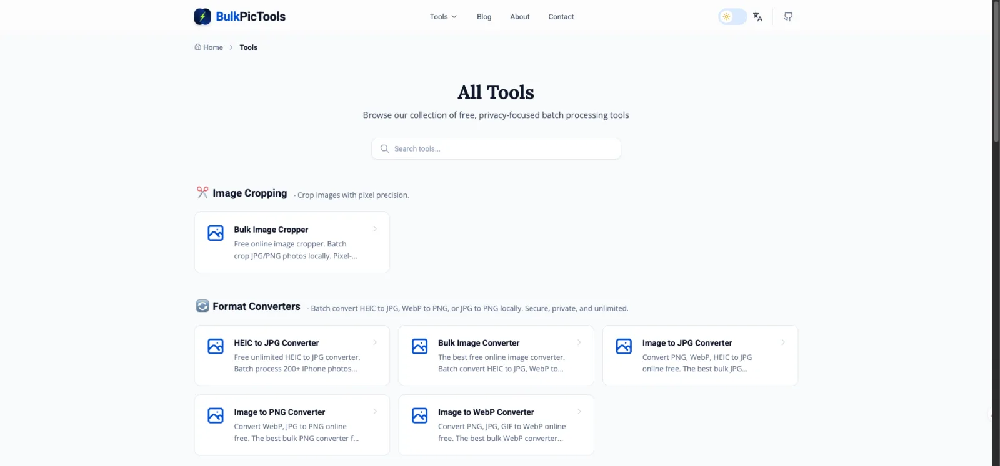
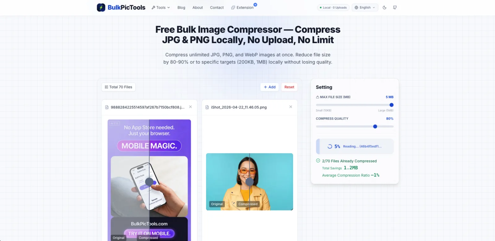
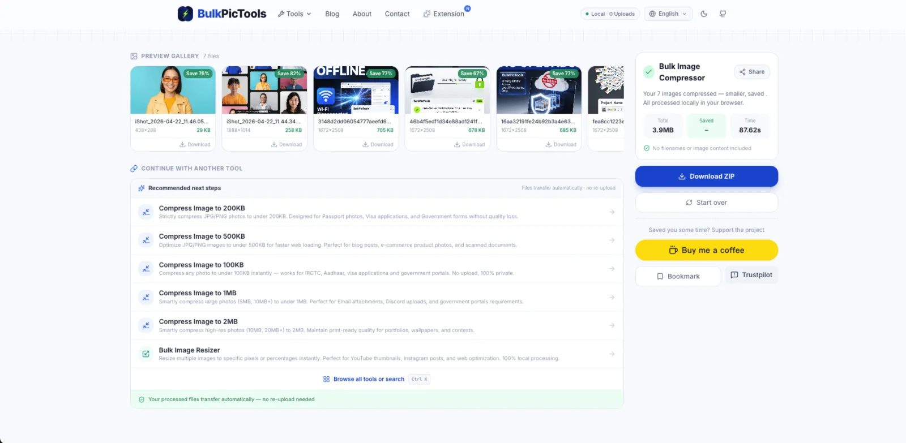

# BulkPicTools

**Batch image tools. Zero uploads. Ever.**

[English](README.md) · [简体中文](README.zh-CN.md)

**[BulkPicTools](https://bulkpictools.com)** is a privacy-first, browser-based batch image toolbox with **100+ tools across 11 categories**. Every operation runs locally on your device with WebAssembly and Web Workers: your photos are never uploaded, queued, or stored on a server. Chain several tools in one session, process hundreds of images at once, and keep working offline after the first load.

> **Quote-ready blurb:** *BulkPicTools is a free, privacy-first batch image toolbox with 100+ tools. All processing happens locally in the browser via WebAssembly — no uploads, no server queues, and no image data leaving your device.*

---

## Why BulkPicTools

| | Traditional online tools | BulkPicTools |
| :--- | :---: | :---: |
| **Speed** | Upload, then wait | ⚡ Instant, local processing |
| **Privacy** | Files sent to a server | 🔒 100% on-device |
| **Batch size** | 10–20 files | ♾️ Hundreds at once |
| **File size limit** | 5–10 MB | 🚫 None |
| **Offline** | Requires a connection | ✅ Works offline |
| **Workflow** | One tool per upload | 🔗 Chain tools, no re-upload |
| **Price** | Paid / freemium | 🆓 Free forever, no account |

What makes it different:

- **100+ tools, 11 categories** — conversion, compression, cropping, resizing, GIF, EXIF, effects, watermarking and local AI.
- **Tool chaining** — compress → convert → crop → resize in a single session; results are passed to the next tool without another upload.
- **10 scene workflows** — prebuilt multi-step flows for app icons, contact sheets, before/after photos and more.
- **Local AI** — background removal, upscaling, object/watermark removal and face blurring, all running on-device.

---

## Inside the app

| Browse the catalog | Process hundreds at once | Download and keep going |
| :---: | :---: | :---: |
|  |  |  |
| [All 100+ tools](https://bulkpictools.com/tools) | Web Workers keep the UI responsive | ZIP, individual files, or chain another tool |

---

## Tools — 100+ across 11 categories

A representative selection from each category. Every link opens the live tool.

### 🔄 Format Converters

| Tool | What it does |
| :--- | :--- |
| [Bulk Image Converter](https://bulkpictools.com/tools/convert/image-converter) | Batch convert between JPG, PNG, WebP, AVIF, HEIC and more |
| [HEIC to JPG](https://bulkpictools.com/tools/convert/heic-to-jpg) | Convert iPhone photos locally, in bulk |
| [Any to WebP](https://bulkpictools.com/tools/convert/to-webp) | Smaller files for faster websites |
| [Any to JPG](https://bulkpictools.com/tools/convert/to-jpg) | Universal format, batch conversion |
| [SVG to PNG](https://bulkpictools.com/tools/convert/svg-to-png) | Custom size, DPI and background |

[Browse all converters →](https://bulkpictools.com/tools/convert)

### 📦 Compression

| Tool | What it does |
| :--- | :--- |
| [Bulk Image Compressor](https://bulkpictools.com/tools/compress/image-compressor) | Compress JPG, PNG, WebP and AVIF with quality control |
| [Compress to 100 KB](https://bulkpictools.com/tools/compress/compress-to-100kb) | Hit the exact limit for forms, visas and portals |
| [Compress to 1 MB](https://bulkpictools.com/tools/compress/compress-to-1mb) | Fit email and upload limits |
| [Compress to 20 KB](https://bulkpictools.com/tools/compress/compress-to-20kb) | Tight size targets without guesswork |
| [Reddit PFP Compressor](https://bulkpictools.com/tools/compress/reddit-pfp-compressor) | Optimize profile pictures |

[Browse all compression tools →](https://bulkpictools.com/tools/compress)

### ✂️ Cropping

| Tool | What it does |
| :--- | :--- |
| [Bulk Image Cropper](https://bulkpictools.com/tools/crop/image-cropper) | Fixed ratios or custom pixel dimensions |
| [Passport Photo Cropper](https://bulkpictools.com/tools/crop/passport-photo-cropper) | Standard 35×45 mm, 2×2 in and other ID sizes |
| [2×2 Photo Cropper](https://bulkpictools.com/tools/crop/2x2-photo-cropper) | US visa, passport and OCI compliant |
| [Circle Image Cropper](https://bulkpictools.com/tools/crop/circle-image-cropper) | Perfect circles with transparent PNG output |

[Browse all cropping tools →](https://bulkpictools.com/tools/crop)

### 📐 Resizing

| Tool | What it does |
| :--- | :--- |
| [Bulk Image Resizer](https://bulkpictools.com/tools/resize/image-resizer) | By pixels, percentage or longest side |
| [Instagram Resizer](https://bulkpictools.com/tools/resize/instagram-resizer) | Post, story and profile presets |
| [YouTube Thumbnail Resizer](https://bulkpictools.com/tools/resize/youtube-thumbnail-resizer) | 1280×720 thumbnails in one click |
| [4×6 Photo Resizer](https://bulkpictools.com/tools/resize/4x6-photo-resizer) | Print-size presets |
| [Fixed-size pages](https://bulkpictools.com/tools/resize) | Dedicated pages for 100×100, 512×512, 1280×720 and more |

[Browse all resizing tools →](https://bulkpictools.com/tools/resize)

### 🔁 Rotate & Flip

| Tool | What it does |
| :--- | :--- |
| [Bulk Image Rotator](https://bulkpictools.com/tools/rotate/image-rotator) | Rotate 90°/180°/270° in batch |
| [Bulk Image Flipper](https://bulkpictools.com/tools/rotate/image-flipper) | Horizontal and vertical flips |

### 🎞️ GIF Tools

| Tool | What it does |
| :--- | :--- |
| [GIF Maker](https://bulkpictools.com/tools/gif/gif-maker) | Build animated GIFs from images |
| [GIF Compressor](https://bulkpictools.com/tools/gif/gif-compressor) | Shrink GIFs locally |
| [Video to GIF](https://bulkpictools.com/tools/gif/video-to-gif) | MP4/MOV/WebM with trim and FPS control |
| [GIF to MP4](https://bulkpictools.com/tools/gif/gif-to-mp4) | Turn animations into video |
| [GIF Frame Extractor](https://bulkpictools.com/tools/gif/gif-frame-extractor) | Export individual frames |

[Browse all GIF tools →](https://bulkpictools.com/tools/gif)

### 🎨 Adjust & Effects

| Tool | What it does |
| :--- | :--- |
| [Change Brightness](https://bulkpictools.com/tools/adjust/change-image-brightness) | Batch brightness adjustment |
| [Adjust Contrast](https://bulkpictools.com/tools/adjust/adjust-image-contrast) | Contrast control with live preview |
| [Merge Images](https://bulkpictools.com/tools/edit/merge-images) | Side-by-side and grid compositions |
| [Split Image](https://bulkpictools.com/tools/edit/split-image) | Grid tiles, including Instagram 3×3 |
| [Round Corners](https://bulkpictools.com/tools/edit/round-corners) | Per-corner radius control |

[Browse all editing tools →](https://bulkpictools.com/tools/edit)

### 💧 Watermark

| Tool | What it does |
| :--- | :--- |
| [Batch Image Watermark](https://bulkpictools.com/tools/watermark/image-watermark) | Text or logo watermarks across hundreds of images |

### 🔍 EXIF & DPI

| Tool | What it does |
| :--- | :--- |
| [EXIF Viewer](https://bulkpictools.com/tools/exif/exif-viewer) | Inspect GPS, camera settings and embedded metadata |
| [EXIF Editor](https://bulkpictools.com/tools/exif/exif-editor) | Edit or strip metadata before sharing |
| [DPI Checker](https://bulkpictools.com/tools/exif/dpi-checker) | Pixel dimensions and print size |
| [DPI Converter](https://bulkpictools.com/tools/exif/dpi-converter) | Set 72/150/300 DPI for print |

### 🤖 Local AI

| Tool | What it does |
| :--- | :--- |
| [Remove Background](https://bulkpictools.com/tools/ai/remove-background) | Cut out portraits and products on-device |
| [Image Upscaler](https://bulkpictools.com/tools/ai/image-upscaler) | 2×/4× super-resolution |
| [Remove Object](https://bulkpictools.com/tools/ai/remove-object) | Paint over objects and let AI fill them in |
| [Remove Watermark](https://bulkpictools.com/tools/ai/remove-watermark) | Erase overlays locally |
| [Unpixelate Image](https://bulkpictools.com/tools/ai/unpixelate-image) | Enhance pixelated or blurry photos |

[Browse all AI tools →](https://bulkpictools.com/tools/ai)

---

## Scene workflows

Scenes package several tools into one guided flow. **10 scenes are live**, including:

- [App Icon Package Generator](https://bulkpictools.com/scenes/app-icon-package-generator) — all iOS, Android and web icon sizes from one image.
- [Batch Image Processing](https://bulkpictools.com/scenes/batch-image-processing) — one pass for a whole folder.
- [Contact Sheet Maker](https://bulkpictools.com/scenes/contact-sheet-maker) — arrange a set of photos into a sheet.
- [Before & After Photo Maker](https://bulkpictools.com/scenes/before-and-after-photo-maker) — comparison images without re-uploading.
- [Photo to Cross Stitch](https://bulkpictools.com/scenes/photo-to-cross-stitch) — turn a photo into a stitch pattern.

[**Browse all scenes →**](https://bulkpictools.com/scenes)

---

## Local AI, in your browser

Background removal, upscaling, object and watermark removal, face blurring and depixelation run on ONNX Runtime Web with WebGPU/WASM. The model is downloaded once and cached; your images stay on the device. No image is ever sent to an inference server.

---

## How it works

1. **📂 Select files** — Drag and drop images, folders, or ZIP archives. No upload wait.
2. **⚙️ Process locally** — WebAssembly engines and Web Workers do the work in your browser.
3. **🔗 Chain tools** — Move results straight into the next tool without re-uploading.
4. **💾 Save** — Download a ZIP or individual files, then continue from the results page.

---

## Architecture & tech stack

- **Framework** — Nuxt 4, Vue 3, TypeScript, Tailwind CSS.
- **Rendering** — static prerendering (`nitro.preset: 'static'`) on Cloudflare Pages, plus a PWA service worker for offline use.
- **Processing** — Web Workers, Canvas/OffscreenCanvas, WebAssembly (ImageMagick WASM, WebP WASM), ONNX Runtime Web with WebGPU for AI models.
- **Storage** — IndexedDB for results (automatically cleared), Cache API for offline assets.
- **Large assets** — AI models and the ONNX Runtime WASM binary are served from Cloudflare R2, because Cloudflare Pages caps individual files at 25 MiB.
- **Internationalization** — 11 locales with `prefix_except_default` routing; English has no URL prefix.
- **Analytics** — count-only metadata. No filenames, URLs, image contents or user identifiers are collected.

This is what makes zero-upload batch editing, offline usage and tool chaining possible without a processing backend.

---

## Privacy & data

No server-side image processing. Images never leave your device; results live in your browser's IndexedDB and are cleared automatically. The site records only aggregate, count-style usage metadata — never file names, URLs or image contents. See the [privacy policy](https://bulkpictools.com/privacy).

---

## Languages

The interface and tool pages are available in **11 languages**: English, 简体中文, 繁體中文（香港）, 繁體中文（台灣）, 日本語, Español, Français, Deutsch, हिन्दी, Bahasa Indonesia and Português. Non-English versions live under a language prefix, for example [`bulkpictools.com/zh/tools`](https://bulkpictools.com/zh/tools).

---

## Typical use cases

- **E-commerce sellers** — compress, convert and standardize product photos for Shopify or Amazon.
- **Developers & designers** — export a complete set of app icon sizes from one source image.
- **Everyday users** — batch convert iPhone HEIC photos to JPG, or strip EXIF before sharing.
- **Content creators** — build, compress and resize GIFs and social images.

---

## By the numbers

- **100+** free tools in **11** categories
- **10** live scene workflows
- **11** languages
- **0** server uploads

The site reports 1M+ images processed and 50K+ users.

---

## Blog

- [Zero-Server Image Editing: The Future of Bulk Image Processing Speed and Privacy](https://bulkpictools.com/blog/zero-server-image-editing-indexeddb-wasm)
- [2026 Image Conversion Guide: Why Your Website Still Loads Like a Turtle](https://bulkpictools.com/blog/image-converter-webp-avif-performance-guide)
- [Why I Always Strip EXIF Data Before Posting Photos Online](https://bulkpictools.com/blog/exif-privacy-guide-2026)
- [2026 Image Resizer Guide: How to Batch Resize Without Quality Loss](https://bulkpictools.com/blog/batch-resize-images-without-quality-loss)

[**View all articles →**](https://bulkpictools.com/blog)

---

## Links

[Website](https://bulkpictools.com) · [All tools](https://bulkpictools.com/tools) · [Scenes](https://bulkpictools.com/scenes) · [Blog](https://bulkpictools.com/blog) · [中文版](https://bulkpictools.com/zh) · [Privacy](https://bulkpictools.com/privacy) · [GitHub](https://github.com/kbmjj123/BulkPicTools)

This repository hosts the project documentation and landing page. The web app itself runs at [bulkpictools.com](https://bulkpictools.com).

---

## License

[MIT](LICENSE) © BulkPicTools

<a href="#">⬆️ Back to top</a>

