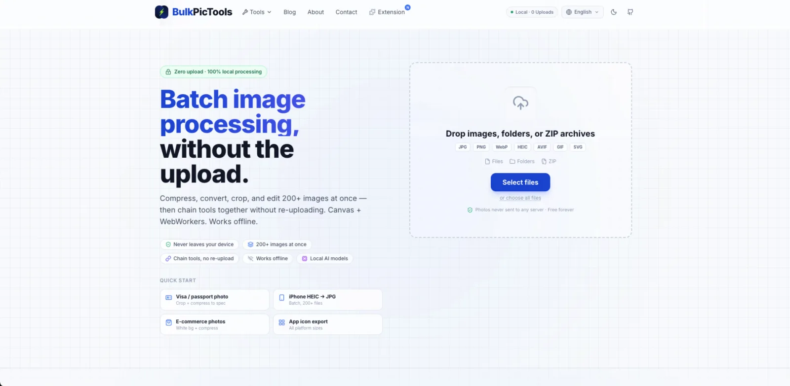
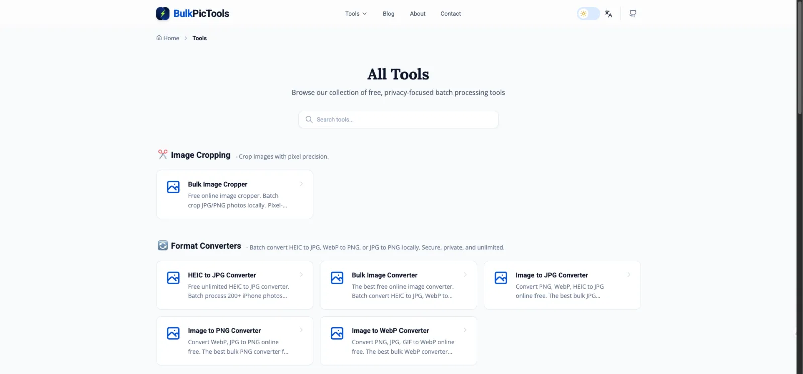
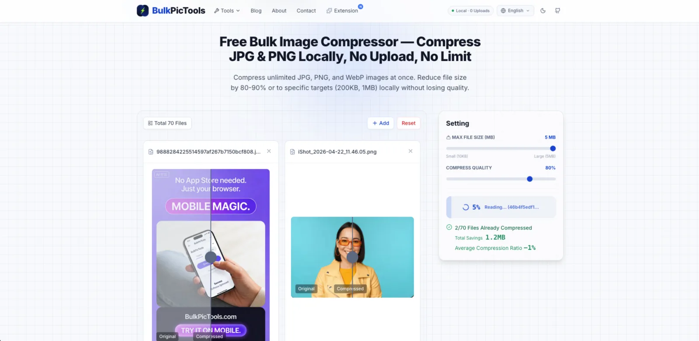
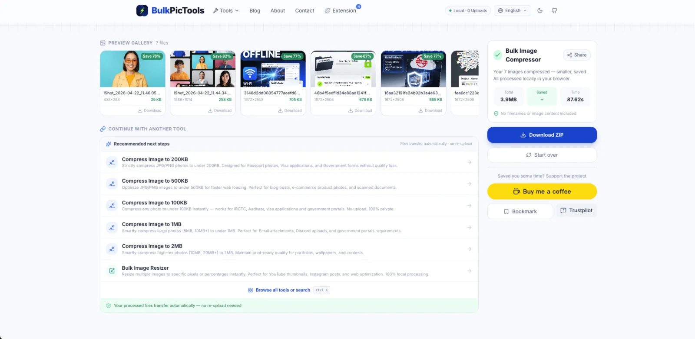

# BulkPicTools

**批量处理图片，永不上传。**

[English](README.md) · 简体中文

**[BulkPicTools](https://bulkpictools.com/zh)** 是一款隐私优先、基于浏览器的批量图片处理工具箱，提供 **11 个分类、100+ 款工具**。所有操作都通过 WebAssembly 与 Web Workers 在您的设备本地完成：照片不会上传、不会排队，也不会存储在任何服务器上。您可以在一次会话中串联多个工具，一次处理数百张图片，首次加载后还能离线使用。

> **可直接引用的介绍：** *BulkPicTools 是一个免费、隐私优先的批量图片处理工具箱，提供 100+ 款工具。所有处理都在浏览器本地通过 WebAssembly 完成，无需上传、没有服务器队列，图片数据不会离开设备。*

---

## 为什么选择 BulkPicTools

| | 传统在线工具 | BulkPicTools |
| :--- | :---: | :---: |
| **速度** | 上传后等待 | ⚡ 本地即时处理 |
| **隐私** | 文件传到服务器 | 🔒 100% 留在设备 |
| **批量数量** | 10–20 张 | ♾️ 一次数百张 |
| **文件大小** | 限制 5–10MB | 🚫 无限制 |
| **离线** | 必须联网 | ✅ 支持离线 |
| **工作流** | 一次只能用一个工具 | 🔗 工具串联，无需重传 |
| **价格** | 付费 / 限免 | 🆓 永久免费，无需注册 |

核心差异：

- **100+ 工具、11 个分类** —— 格式转换、压缩、裁剪、缩放、GIF、EXIF、图像效果、水印与本地 AI。
- **工具链** —— 压缩 → 转换 → 裁剪 → 缩放一次完成，结果直接传给下一个工具，不用重新上传。
- **10 个场景工作流** —— 应用图标、拼图、对比图等多步骤流程，开箱即用。
- **本地 AI** —— 去背、超分、去物体/去水印、人脸模糊全部在设备上运行。

---

## 界面一览

| 浏览全部工具 | 一次处理数百张 | 下载或继续下一步 |
| :---: | :---: | :---: |
|  |  |  |
| [全部 100+ 工具](https://bulkpictools.com/zh/tools) | Web Workers 保证界面不卡顿 | 打包 ZIP、单张下载，或直接串联下一个工具 |

---

## 工具：11 个分类，100+ 款

下面按分类列出代表工具，每个链接都可直达线上工具页。

### 🔄 格式转换

| 工具 | 说明 |
| :--- | :--- |
| [批量图片格式转换](https://bulkpictools.com/zh/tools/convert/image-converter) | JPG、PNG、WebP、AVIF、HEIC 等批量互转 |
| [HEIC 转 JPG](https://bulkpictools.com/zh/tools/convert/heic-to-jpg) | 本地批量转换 iPhone 照片 |
| [转 WebP](https://bulkpictools.com/zh/tools/convert/to-webp) | 体积更小，网页加载更快 |
| [转 JPG](https://bulkpictools.com/zh/tools/convert/to-jpg) | 通用格式批量转换 |
| [SVG 转 PNG](https://bulkpictools.com/zh/tools/convert/svg-to-png) | 自定义尺寸、DPI 与背景色 |

[查看全部转换工具 →](https://bulkpictools.com/zh/tools/convert)

### 📦 图片压缩

| 工具 | 说明 |
| :--- | :--- |
| [批量图片压缩](https://bulkpictools.com/zh/tools/compress/image-compressor) | 压缩 JPG、PNG、WebP、AVIF，可控画质 |
| [压缩到 100KB](https://bulkpictools.com/zh/tools/compress/compress-to-100kb) | 满足表格、签证、政务门户的精确限制 |
| [压缩到 1MB](https://bulkpictools.com/zh/tools/compress/compress-to-1mb) | 适配邮件附件与上传大小限制 |
| [压缩到 20KB](https://bulkpictools.com/zh/tools/compress/compress-to-20kb) | 极限体积，无需反复试错 |
| [Reddit 头像压缩](https://bulkpictools.com/zh/tools/compress/reddit-pfp-compressor) | 针对头像尺寸优化 |

[查看全部压缩工具 →](https://bulkpictools.com/zh/tools/compress)

### ✂️ 图片裁剪

| 工具 | 说明 |
| :--- | :--- |
| [批量图片裁剪](https://bulkpictools.com/zh/tools/crop/image-cropper) | 固定比例或自定义像素尺寸 |
| [证件照裁剪](https://bulkpictools.com/zh/tools/crop/passport-photo-cropper) | 35×45mm、2×2 英寸等标准证件照尺寸 |
| [2 寸照片裁剪](https://bulkpictools.com/zh/tools/crop/2x2-photo-cropper) | 符合美签、护照、OCI 要求 |
| [圆形图片裁剪](https://bulkpictools.com/zh/tools/crop/circle-image-cropper) | 输出透明背景 PNG 的正圆图片 |

[查看全部裁剪工具 →](https://bulkpictools.com/zh/tools/crop)

### 📐 图片缩放

| 工具 | 说明 |
| :--- | :--- |
| [批量图片缩放](https://bulkpictools.com/zh/tools/resize/image-resizer) | 按像素、百分比或最长边缩放 |
| [Instagram 尺寸](https://bulkpictools.com/zh/tools/resize/instagram-resizer) | 帖子、快拍、头像预设 |
| [YouTube 封面](https://bulkpictools.com/zh/tools/resize/youtube-thumbnail-resizer) | 一键生成 1280×720 封面 |
| [4×6 照片尺寸](https://bulkpictools.com/zh/tools/resize/4x6-photo-resizer) | 常见冲印尺寸预设 |
| [固定尺寸页面](https://bulkpictools.com/zh/tools/resize) | 100×100、512×512、1280×720 等专用页面 |

[查看全部缩放工具 →](https://bulkpictools.com/zh/tools/resize)

### 🔁 旋转与翻转

| 工具 | 说明 |
| :--- | :--- |
| [批量图片旋转](https://bulkpictools.com/zh/tools/rotate/image-rotator) | 批量旋转 90°/180°/270° |
| [批量图片翻转](https://bulkpictools.com/zh/tools/rotate/image-flipper) | 水平、垂直批量翻转 |

### 🎞️ GIF 工具

| 工具 | 说明 |
| :--- | :--- |
| [GIF 制作](https://bulkpictools.com/zh/tools/gif/gif-maker) | 用多张图片合成动图 |
| [GIF 压缩](https://bulkpictools.com/zh/tools/gif/gif-compressor) | 本地缩小 GIF 体积 |
| [视频转 GIF](https://bulkpictools.com/zh/tools/gif/video-to-gif) | MP4/MOV/WebM，支持裁剪与帧率控制 |
| [GIF 转 MP4](https://bulkpictools.com/zh/tools/gif/gif-to-mp4) | 把动图转成视频 |
| [GIF 抽帧](https://bulkpictools.com/zh/tools/gif/gif-frame-extractor) | 导出单帧图片 |

[查看全部 GIF 工具 →](https://bulkpictools.com/zh/tools/gif)

### 🎨 调整与效果

| 工具 | 说明 |
| :--- | :--- |
| [调整亮度](https://bulkpictools.com/zh/tools/adjust/change-image-brightness) | 批量调整亮度 |
| [调整对比度](https://bulkpictools.com/zh/tools/adjust/adjust-image-contrast) | 实时预览对比度 |
| [图片合并](https://bulkpictools.com/zh/tools/edit/merge-images) | 左右拼接、网格合成 |
| [切图 / 九宫格](https://bulkpictools.com/zh/tools/edit/split-image) | 网格切分，含 Instagram 3×3 |
| [圆角图片](https://bulkpictools.com/zh/tools/edit/round-corners) | 每个角可单独设置圆角 |

[查看全部编辑工具 →](https://bulkpictools.com/zh/tools/edit)

### 💧 水印

| 工具 | 说明 |
| :--- | :--- |
| [批量图片水印](https://bulkpictools.com/zh/tools/watermark/image-watermark) | 为数百张图片批量加文字或 Logo 水印 |

### 🔍 EXIF 与 DPI

| 工具 | 说明 |
| :--- | :--- |
| [EXIF 查看器](https://bulkpictools.com/zh/tools/exif/exif-viewer) | 查看 GPS、相机参数等嵌入信息 |
| [EXIF 编辑器](https://bulkpictools.com/zh/tools/exif/exif-editor) | 分享前编辑或清除元数据 |
| [DPI 查看器](https://bulkpictools.com/zh/tools/exif/dpi-checker) | 查看像素尺寸与打印尺寸 |
| [DPI 转换器](https://bulkpictools.com/zh/tools/exif/dpi-converter) | 设置 72/150/300 DPI 用于打印 |

### 🤖 本地 AI

| 工具 | 说明 |
| :--- | :--- |
| [AI 去背](https://bulkpictools.com/zh/tools/ai/remove-background) | 本地抠出人像与商品图 |
| [AI 超分](https://bulkpictools.com/zh/tools/ai/image-upscaler) | 2×/4× 超分辨率放大 |
| [AI 去物体](https://bulkpictools.com/zh/tools/ai/remove-object) | 涂抹后自动擦除并补全 |
| [AI 去水印](https://bulkpictools.com/zh/tools/ai/remove-watermark) | 本地擦除叠加水印 |
| [AI 去马赛克](https://bulkpictools.com/zh/tools/ai/unpixelate-image) | 增强打码或模糊的照片 |

[查看全部 AI 工具 →](https://bulkpictools.com/zh/tools/ai)

---

## 场景工作流

场景把多个工具打包成一条完整流程，目前 **10 个场景已上线**，例如：

- [应用图标套装生成](https://bulkpictools.com/zh/scenes/app-icon-package-generator) —— 一张源图导出 iOS、Android、Web 全部图标尺寸。
- [批量图片处理](https://bulkpictools.com/zh/scenes/batch-image-processing) —— 整个文件夹一次处理完。
- [拼图 / 联系表生成](https://bulkpictools.com/zh/scenes/contact-sheet-maker) —— 把一组照片排成一张图。
- [前后对比图制作](https://bulkpictools.com/zh/scenes/before-and-after-photo-maker) —— 不用重新上传即可生成对比图。
- [照片转十字绣](https://bulkpictools.com/zh/scenes/photo-to-cross-stitch) —— 把照片转成十字绣图纸。

[**查看全部场景 →**](https://bulkpictools.com/zh/scenes)

---

## 浏览器里的本地 AI

去背、超分、去物体与去水印、人脸模糊、去马赛克等功能基于 ONNX Runtime Web，通过 WebGPU/WASM 在设备端推理。模型只需下载一次并缓存，图片始终留在本地，不会发送到任何推理服务器。

---

## 使用步骤

1. **📂 选择文件** —— 拖入图片、文件夹或 ZIP 压缩包，无需等待上传。
2. **⚙️ 本地处理** —— WebAssembly 引擎与 Web Workers 在浏览器中完成运算。
3. **🔗 串联工具** —— 结果直接进入下一个工具，不用重新上传。
4. **💾 保存结果** —— 打包下载 ZIP 或逐张下载，也可从结果页继续处理。

---

## 架构与技术栈

- **框架** —— Nuxt 4、Vue 3、TypeScript、Tailwind CSS。
- **渲染** —— 静态预渲染（`nitro.preset: 'static'`）部署在 Cloudflare Pages，配合 PWA Service Worker 支持离线。
- **处理** —— Web Workers、Canvas/OffscreenCanvas、WebAssembly（ImageMagick WASM、WebP WASM），AI 模型使用 ONNX Runtime Web + WebGPU。
- **存储** —— 结果存 IndexedDB 并自动清理，离线资源走 Cache API。
- **大文件** —— AI 模型与 ONNX Runtime WASM 二进制托管在 Cloudflare R2，因为 Cloudflare Pages 单文件上限为 25MiB。
- **国际化** —— 11 个语种，采用 `prefix_except_default` 路由，英文无 URL 前缀。
- **统计** —— 仅记录计数型元数据，不采集文件名、URL、图片内容或用户标识。

正是这套架构，让「零上传」批量编辑、离线使用与工具串联不需要后端算力。

---

## 隐私与数据

没有服务端图片处理，图片不会离开设备；结果保存在浏览器 IndexedDB 中并自动清理。站点只记录汇总后的计数型使用数据，绝不包含文件名、URL 或图片内容。详见[隐私政策](https://bulkpictools.com/zh/privacy)。

---

## 多语言

界面与工具页支持 **11 个语种**：English、简体中文、繁體中文（香港）、繁體中文（台灣）、日本語、Español、Français、Deutsch、हिन्दी、Bahasa Indonesia、Português。非英文版本使用语言前缀，例如 [`bulkpictools.com/zh/tools`](https://bulkpictools.com/zh/tools)。

---

## 典型使用场景

- **电商卖家** —— 为 Shopify、Amazon 批量压缩、转换并统一商品图规格。
- **开发者与设计师** —— 用一张源图导出全套应用图标尺寸。
- **普通用户** —— 批量把 iPhone HEIC 照片转成 JPG，分享前清除 EXIF。
- **内容创作者** —— 制作、压缩并调整 GIF 与社交媒体配图。

---

## 数据一览

- **100+** 免费工具，覆盖 **11** 个分类
- **10** 个已上线场景工作流
- **11** 个语种
- **0** 次服务器上传

站点公布的累计数据为：处理图片 100 万+、用户 5 万+。

---

## 技术博客

- [为什么要在这个时代做一个「本地化」的图片工具？](https://bulkpictools.com/zh/blog/introducing-bulkpictools)
- [图片批量处理不用来回倒腾：一次上传走完全流程](https://bulkpictools.com/zh/blog/image-processing-pipeline)
- [图片合并 — 免费在线图片合并工具，无需上传（2026年）](https://bulkpictools.com/zh/blog/merge-images-online-free)
- [2026 全球护照照片尺寸速查表](https://bulkpictools.com/zh/blog/passport-photo-size-cheat-sheet-2026)
- [SVG 转 PNG 避坑指南：currentColor 陷阱、@2x 多倍率与模糊问题解决](https://bulkpictools.com/zh/blog/svg-to-png-guide)

[**查看全部文章 →**](https://bulkpictools.com/zh/blog)

---

## 相关链接

[中文站首页](https://bulkpictools.com/zh) · [全部工具](https://bulkpictools.com/zh/tools) · [场景](https://bulkpictools.com/zh/scenes) · [博客](https://bulkpictools.com/zh/blog) · [English](https://bulkpictools.com) · [隐私政策](https://bulkpictools.com/zh/privacy) · [GitHub](https://github.com/kbmjj123/BulkPicTools)

本仓库用于存放项目文档与介绍落地页，网页应用本身运行在 [bulkpictools.com](https://bulkpictools.com)。

---

## 许可

[MIT](LICENSE) © BulkPicTools

<a href="#">⬆️ 回到顶部</a>

